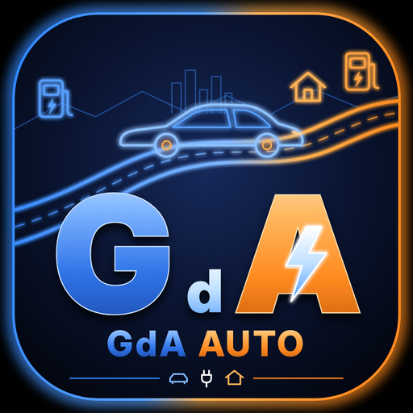

  

<h3 align="center">Tutte le auto elettriche in Home Assistant, con la stessa faccia. E dentro GdAHome e gdanav da sole.</h3>

  49 marchi: 26 letti direttamente dal loro cloud, gli altri da Home Assistant

---

## Cos'è

GdAAuto è un'integrazione per Home Assistant. Prende la tua auto elettrica,
di qualunque marca, e la fa diventare **un dispositivo sempre uguale**: la
batteria si chiama `sensor.<auto>_batteria`, il cavo
`binary_sensor.<auto>_cavo_collegato`, la serratura `lock.<auto>_serratura`,
con le stesse unità e le stesse classi per tutte.

Per questo **la plancia di GdAHome e gdanav la riconoscono da sole**: scegli
il dispositivo GdAAuto e tutte le caselle si riempiono, senza scrivere un
`entity_id`. Una prova automatica lo controlla col codice vero di tutte e due
a ogni modifica.

## Si comincia dal marchio

Aggiungi GdAAuto e **scegli il marchio** della tua auto. Da lì parte la sua
strada:

- **Il marchio è nativo**: GdAAuto parla direttamente col cloud del
  costruttore, e chiede quello che serve a quella marca (email e password,
  un codice da confermare sul sito, l'accesso col browser…).
- **Il marchio non è nativo**: GdAAuto dice quale integrazione di Home
  Assistant installare, con il link. Quando l'auto c'è, GdAAuto la legge da
  lì e le dà la stessa faccia delle altre.
- **Il marchio non è in elenco**: scegli «Un'altra marca» e prendi l'auto
  da qualunque integrazione già presente in Home Assistant.

Tutto quello che è nativo è **gratis**: usa gli stessi servizi dell'app del
costruttore, senza abbonamenti in più. L'unica eccezione è Tesla, vedi sotto.

## I marchi nativi

| Marchio | Si entra con | Legge | Comanda |
| --- | --- | :---: | --- |
| **Leapmotor** (T03, B05, B10, C10, C16) | account condiviso + certificato dell'app | ✓ | chiudi e apri, clima, ricarica, limite, trova, destinazione (col PIN dell'auto) |
| **Tesla** | app sviluppatore Tesla (Fleet API) | ✓ | chiudi e apri, clima, ricarica, limite, trova, destinazione |
| **Peugeot, Citroën, DS, Opel, Vauxhall** | login nel browser, codice incollato | ✓ | nessuno, per ora |
| **Fiat, Abarth, Jeep, Alfa Romeo, Lancia, Maserati** | email e password dell'app (Uconnect) | ✓ | chiudi e apri, clima, ricarica, trova (col PIN dell'app) |
| **Renault, Dacia, Alpine** | email e password, codice per email se chiesto | ✓ | clima, ricarica, limite, trova (secondo il modello) |
| **Kia, Hyundai, Genesis** (auto europee) | email e password dell'app | ✓ | chiudi e apri, clima, ricarica, limite, destinazione, trova sulle auto recenti (col PIN dell'app) |
| **BMW, Mini** | codice da confermare sul sito MyBMW (CarData) | ✓ | nessuno: BMW CarData è solo lettura |
| **Mercedes-Benz** | email e password di un account invitato | ✓ | chiudi e apri, clima, limite, trova (apri col PIN) |
| **Toyota, Lexus** | email e password di MyToyota / Lexus Link+ | ✓ | chiudi e apri, clima (secondo l'auto) |
| **MG** | email e password di un account secondario | ✓ | chiudi e apri, clima, ricarica, limite, trova |
| **Polestar** | Polestar ID | ✓ | nessuno: Polestar non li apre a terzi |

Un comando compare solo se la tua auto lo accetta: GdAAuto lo chiede al cloud,
o lo sa dal modello.

**Quanto spesso legge**, se non scegli tu nelle opzioni:

| Marchio | Da ferma | In marcia o in carica |
| --- | --- | --- |
| Leapmotor | 5 min | 1 min |
| Tesla, Polestar | 10 min | 2 min |
| Kia, Hyundai, Genesis, Mercedes, Renault, Uconnect | 10 min | 5 min |
| Stellantis | 5 min | 1 min |
| Toyota | 15 min | 10 min |
| MG | 30 min | 5 min |
| BMW | 30 min | 30 min (50 letture al giorno per account) |

## I marchi da Home Assistant

| Marchio | Integrazione da installare |
| --- | --- |
| **BYD** | [hass-byd-vehicle](https://github.com/jkaberg/hass-byd-vehicle) (HACS) |
| **Volkswagen, Audi, Cupra, Seat** | l'integrazione del gruppo per la tua marca ([Audi Connect](https://github.com/audiconnect/audi_connect_ha) per Audi) |
| **Škoda** | [MyŠkoda](https://github.com/skodaconnect/homeassistant-myskoda), o l'integrazione ufficiale |
| **Volvo** | [Volvo](https://www.home-assistant.io/integrations/volvo), ufficiale |
| **Ford** | [FordPass](https://github.com/itchannel/fordpass-ha) (HACS) |
| **Nissan** | Nissan Connect (HACS); [Nissan Leaf](https://www.home-assistant.io/integrations/nissan_leaf) per le Leaf prima del 2019 |
| **Porsche** | [Porsche Connect](https://github.com/CJNE/ha-porscheconnect) (HACS) |
| **Jaguar, Land Rover** | [JLR InControl](https://github.com/msp1974/homeassistant-jlrincontrol) (HACS) |
| **Rivian** | [Rivian](https://github.com/bretterer/home-assistant-rivian) (HACS) |
| **smart** | Hello smart (HACS) per #1 e #3; Mercedes-Benz per le EQ |
| **Lucid, Subaru** | le loro integrazioni (Subaru solo negli Stati Uniti) |

**Perché BYD non è nativa.** Il cloud BYD cifra ogni richiesta con tabelle
estratte dall'app, che nessuno ha il diritto di ridistribuire. GdAAuto non le
copia: passa dall'integrazione della comunità, che l'utente installa da sé.

**Aiways, Honda, Lotus, Lynk & Co, Mazda, NIO, Xpeng e Zeekr** non hanno
ancora un'API che si possa usare. Se un giorno nasce un'integrazione per
Home Assistant, GdAAuto la legge con «Un'altra marca».

Con la strada di Home Assistant GdAAuto guarda le entità del dispositivo
dell'auto e **propone da solo** quale è la batteria, quale l'autonomia, quale
la serratura. Tu controlli e confermi. I comandi passano per le entità vere
dell'auto: chiudere usa la sua serratura, il clima il suo clima, il limite di
ricarica il suo cursore.

## Cosa c'è nel dispositivo

| | Entità |
| --- | --- |
| **Batteria e strada** | batteria, autonomia, contachilometri, velocità, potenza, energia residua, marcia |
| **Ricarica** | in carica, cavo collegato, stato della ricarica, potenza di ricarica, tempo alla fine, limite di ricarica |
| **L'auto** | serratura, portiere, bagagliaio, finestrini, quadro acceso, clima, sentinella, posizione |
| **Diagnostica** | pressione delle quattro gomme, ultimo aggiornamento, pulsante «Aggiorna» |
| **Comandi** | chiudi e apri, clima, avvia e ferma la ricarica, limite di ricarica, trova l'auto (clacson e luci), manda una destinazione al navigatore dell'auto |

Un'entità nasce solo se la tua auto quel dato lo dice: una T03 non ha la
temperatura della batteria, e non avrai un sensore sempre «sconosciuto». Se il
dato arriva più tardi, per esempio alla prima ricarica, l'entità nasce allora.

## Leapmotor

1. **Un account dedicato.** Il cloud Leapmotor tiene una sola sessione per
   account: con lo stesso account l'app sul telefono verrebbe disconnessa.
   Crea un secondo account e, dall'app ufficiale, **condividi l'auto** con lui.
2. **Il certificato dell'app.** Il cloud vuole il certificato dell'app
   Leapmotor (`app_cert.pem`, `app_key.pem`), che non è pubblico e non è in
   questa repository. Lo incolli nella configurazione, oppure metti i due file
   in `/config/gdaauto/`.
3. **Il PIN dell'auto**, nelle opzioni, serve per i comandi. Senza PIN si
   legge tutto e non si comanda niente; la destinazione al navigatore va anche
   senza.

**Quanto spesso legge.** Ogni 5 minuti da ferma, ogni minuto in marcia o in
carica, ogni 15 minuti quando è chiusa e senza cavo. Si cambia nelle opzioni.
Quando qualcuno preme «Aggiorna», o gdanav in viaggio chiede dati freschi, si
legge subito: una lettura sola anche se la chiedono in tanti, mai più di una
ogni 30 secondi.

## Tesla

GdAAuto usa la **Fleet API**, l'API ufficiale di Tesla. Serve un'app
sviluppatore Tesla:

1. **L'app su [developer.tesla.com](https://developer.tesla.com).** Indirizzo
   di ritorno `https://my.home-assistant.io/redirect/oauth`, permessi su dati,
   posizione, comandi e ricarica dell'auto. L'app va registrata nella regione
   dell'auto, con la chiave pubblica pubblicata sul tuo dominio: è lo stesso
   passo che fa l'integrazione Tesla Fleet di Home Assistant. **Se usi già
   Tesla Fleet, l'app ce l'hai: va bene la stessa.**
2. **Le credenziali in Home Assistant.** Impostazioni → Dispositivi e servizi
   → Credenziali applicative → aggiungi, integrazione **GdAAuto**, con il
   Client ID e il Client Secret dell'app.
3. **Aggiungi GdAAuto → Tesla**, ed entra col tuo account Tesla. La regione
   la capisce da sola.

**Quanto costa.** La Fleet API si paga a consumo, ma Tesla regala a ogni
account sviluppatore un credito di 10 $ al mese. Una lettura completa costa
0,002 $, e chiedere se l'auto è sveglia non costa niente: con una o due auto
e il ritmo di GdAAuto si resta dentro il credito, quindi in pratica è
gratis. Chi non vuole un'app sviluppatore può usare un'integrazione Tesla
via Bluetooth (per esempio `ha-tesla-ble`, o un ESP32) e prendere l'auto
con «Un'altra marca».

**L'auto che dorme non si sveglia per leggerla**: ogni lettura e ogni
sveglia costano a chi ha l'app sviluppatore. Da addormentata restano gli
ultimi dati, con l'entità «In sonno» accesa; si sveglia solo per un comando.
Da ferma si legge ogni 10 minuti.

**I comandi firmati.** Le Tesla dal 2021 vogliono i comandi firmati con la
chiave dell'app (Vehicle Command Protocol). Indica nelle opzioni l'indirizzo
del proxy ufficiale di Tesla, `tesla-http-proxy`, che li firma: GdAAuto
manda lì i comandi e continua a leggere dalla Fleet API. Senza proxy i
comandi vanno solo sulle auto più vecchie, e GdAAuto dice perché quando
non passano.

## Stellantis

Peugeot, Citroën, DS, Opel e Vauxhall, elettriche e ibride plug-in, col
cloud dell'app del marchio (MyPeugeot, MyCitroën, MyDS, MyOpel, MyVauxhall).
Fiat, Abarth, Jeep, Alfa Romeo, Lancia e Maserati usano un altro cloud,
Uconnect, che è nativo anche lui.

1. **Aggiungi GdAAuto** e scegli il marchio: l'app giusta è già scelta,
   resta il paese.
2. **Entra nel browser di un computer**, col link che GdAAuto ti mostra e gli
   strumenti per sviluppatori aperti (F12, scheda Rete).
3. Alla fine il browser prova ad aprire un indirizzo come
   `mymap://oauth2redirect/it?code=…` e non ci riesce: **copialo e incollalo**
   in GdAAuto. Va bene anche solo il codice.

Email e password restano nel tuo browser: GdAAuto non le vede e non le
manda a nessuno. Il token si rinnova da solo; se un giorno non va più, Home
Assistant chiede di rifare il login.

## Le altre marche native

Basta scegliere il marchio: il modulo chiede solo quello che serve e spiega
in due righe cosa preparare. Le cose da sapere prima:

- **Un account dedicato** per Leapmotor, MG e Mercedes: con lo stesso
  account l'app sul telefono verrebbe disconnessa. Crea un secondo account e
  condividi (o invita) l'auto dall'account principale.
- **BMW e Mini** si collegano con CarData: nel portale MyBMW crei un Client
  ID, lo incolli in GdAAuto e confermi il codice sul sito. BMW concede 50
  letture al giorno per account, e GdAAuto rallenta da sola se le auto sono
  più di una.
- **Renault, Dacia e Alpine** a volte chiedono un codice per email: scrivilo
  nel campo «codice» e conferma di nuovo. GdAAuto tiene il token, non la
  password.
- **Kia, Hyundai, Genesis, Toyota, Lexus e Uconnect** danno i dati che l'auto ha mandato l'ultima
  volta: GdAAuto non la sveglia per leggerla. MG invece si sveglia a ogni
  lettura, per questo legge ogni mezz'ora.
- **Polestar** e **BMW** si leggono soltanto: i costruttori non aprono i
  comandi alle app di terzi.

## La sicurezza dei comandi

- **Aprire l'auto da lontano è spento** finché non lo accendi nelle opzioni.
  Chiudere si può sempre.
- Ogni comando si accende o si spegne a parte, nelle opzioni.
- Il PIN, la password, i token e i certificati non escono mai da Home
  Assistant. I certificati stanno in `.storage/gdaauto`, leggibili solo da
  Home Assistant.
- La diagnostica toglie email, password, PIN, token, VIN, targa e posizione.

## Come arriva a GdAHome e a gdanav

- **GdAHome.** Nella plancia, quando aggiungi l'auto scegliendo integrazione
  e dispositivo, scegli **GdAAuto** e la tua auto. Batteria, autonomia, cavo,
  potenza, limite, serratura, finestrini, gomme e posizione si riempiono da
  soli.
- **gdanav.** Impostazioni → Dispositivi e servizi → Aggiungi integrazione →
  **gdanav**, e come dispositivo scegli quello **GdAAuto**. gdanav riconosce
  batteria, autonomia, ricarica, potenza, velocità, contachilometri,
  temperatura della batteria e posizione. In viaggio, quando gdanav chiede
  dati freschi, GdAAuto rilegge l'auto.

## Installare

1. **HACS** → i tre puntini → **Repository personalizzati**: incolla
   `https://github.com/danigio15/GdAAuto`, categoria **Integrazione**.
2. Cerca **GdAAuto**, installalo e **riavvia** Home Assistant.
3. **Impostazioni → Dispositivi e servizi → Aggiungi integrazione → GdAAuto**,
   e scegli il marchio dell'auto.

Serve Home Assistant 2025.3 o più nuovo. Va su ogni installazione, anche
Container e Core: è un'integrazione, non un add-on.

## Servizi

| Servizio | Cosa fa |
| --- | --- |
| `gdaauto.invia_destinazione` | manda nome, latitudine e longitudine al navigatore dell'auto |
| `gdaauto.aggiorna` | rilegge l'auto adesso |

## Rispetto alle integrazioni Leapmotor che ci sono già

GdAAuto nasce guardando [kerniger/leapmotor-ha](https://github.com/kerniger/leapmotor-ha),
[markoceri/leapmotor-api](https://github.com/markoceri/leapmotor-api),
[helix-git/ha-leapmotor-gateway](https://github.com/helix-git/ha-leapmotor-gateway)
e [leapmotor-mate](https://github.com/ProtossBlaster/leapmotor-mate). Cosa fa
di diverso:

- **Più marche, una faccia.** Le altre sono solo Leapmotor; GdAAuto mette
  26 marchi nativi e le auto di Home Assistant sotto le stesse entità.
- **Asincrona davvero.** Il TLS reciproco col cloud lo fa `aiohttp`; non si
  lancia `curl` in un processo a parte per ogni richiesta.
- **Il ritmo segue l'auto**: più spesso in marcia e in carica, meno da chiusa.
- **Aprire da lontano è spento di base.**
- **Provata contro un cloud finto col TLS reciproco vero**: login, firme,
  rinnovo del token, ripiego sulla C10, comandi col PIN.

Cosa ha preso da loro, e con quale licenza, è in
[RINGRAZIAMENTI.md](RINGRAZIAMENTI.md).

## Per chi sviluppa

Come aggiungere una marca: [docs/AGGIUNGERE-UNA-MARCA.md](docs/AGGIUNGERE-UNA-MARCA.md).

    pip install -r requirements_test.txt ruff
    ruff check custom_components tests && ruff format --check custom_components tests
    pytest

Le prove di `tests/test_sorelle.py` cercano gdanav e gdahomeapp accanto a
questa cartella, oppure in `GDANAV_DIR` e `GDAHOME_DIR`; senza, si saltano.
Il logo si rifà da `docs/logo/logo.svg` con `node docs/logo/rendi.mjs`.

## Avvertenze

GdAAuto non è prodotto né sostenuto da nessuno dei costruttori citati. Tranne
Tesla Fleet e BMW CarData, i cloud delle marche non sono documentati
pubblicamente: possono cambiare senza preavviso, e l'uso resta sotto le loro
condizioni. I comandi agiscono su
un'auto vera.

## Licenza

Licenza d'uso di GdAAuto 1.0 ([LICENSE](LICENSE)): il codice è pubblico per
essere letto, ma non è open source. Titolare Giovanni d'Aniello, distributore
CRV Immobiliare S.r.l.
